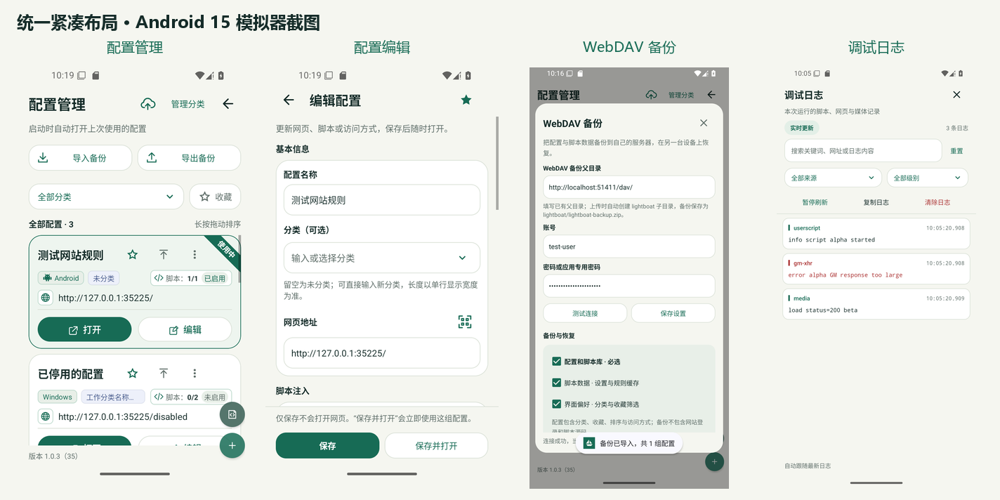

# 原生界面紧凑布局验收（2026-10-22）

保留原深绿、浅绿底和蓝色分类标签，保持 `com.lightboat.app`、`1.0.3 (35)` 和固定 debug 签名。本地 `dev` 开发，未提交、未推送。

## 布局

- 配置卡片按参考图调整：脚本徽标在平台/分类右侧，数字表示启用数/总数；依用户确认使用“已启用”，不把开关状态描述成实际执行状态。停用与空库分别显示“未启用”“无脚本”。
- 按用户最终确认，“使用中”改为三点按钮正上方的半透明小横向标签，上次使用保留灰色状态。三个工具按钮恢复添加角徽前的 48×48dp 区域、原始图标大小和水平居中对齐，标题保持单行省略。标签不占布局空间、不拦截点击；去掉卡片原有 6dp 顶部留白。网址、打开和编辑保留图标及等宽按钮，脚本徽标在窄屏大字体下换行。
- 配置管理、编辑器、脚本库、分类管理、备注、导入/导出、WebDAV、日志、切换配置、浏览菜单、退出确认及扫码标题栏采用一致的紧凑间距。页面边距一般 16dp，区块间距 12dp，相邻元素 8dp；表单标签 13sp、输入 14sp、弹窗标题 20sp。
- 主要按钮保持至少 48dp 触控区域，可见背景约 40dp；文字随系统字体缩放，空间不足时允许按钮增长高度。
- 高度小于 480dp 时，配置管理页收起辅助说明、数量/排序提示和版本栏，为列表保留空间；导入、导出、筛选和卡片操作保留。竖屏恢复这些辅助信息。
- 分类管理正文滚动条继续隐藏，滑动功能保留。

尺寸集中在 `app/src/main/res/values/dimens.xml`，表单样式位于 `styles.xml`；同步调整了备注、切换配置和脚本编辑器中会覆盖 XML 的原生间距代码。没有修改网页或媒体内容的缩放，也没有修改浏览、播放、备份格式或脚本执行逻辑。

## 验证

Android 15 / WebView 124.0.6367.219，Pixel 4 XL 临时只读模拟器 `emulator-5556`。每轮设备验证前安装对应应用及测试 APK，并检查 instrumentation 的最终结果。

| 范围 | 结果 |
| --- | --- |
| `ProfileCardUiTest`：卡片展示、真实点击、复用及窄屏排版 | 3/3 |
| `ScriptLibraryUiTest`：草稿、计数、列表复用、横屏键盘 | 15/15 |
| `CategoryManagementUiTest` | 6/6 |
| `ProfileNoteUiTest`：保存、重建、选择与复制、横屏正文/按钮 | 5/5 |
| `ProfileFilterPersistenceTest`：含原 WebView 与页面内容保留 | 7/7 |
| `DebugLogFilteringTest` | 5/5 |
| WebDAV 完整备份恢复、本地 ZIP 导出导入两个 UI 用例 | 2/2 |
| 360×640dp / 1.0 字体，卡片完整类 | 3/3 |
| 320×640dp / 2.0 字体，卡片完整类 | 3/3 |
| 480×320dp / 2.0 字体，列表空间及卡片排版；分类管理 | 1/1；6/6 |
| `testDebugUnitTest` | 138 项，0 失败/错误/跳过 |
| `lintDebug` | 0 Error，107 Warning |
| `assembleDebug` / `assembleDebugAndroidTest` | 成功 |
| 固定签名校验 / `git diff --check` | 通过 |

43 个不同设备回归用例通过；表中小屏矩阵及最终横屏键盘单跑是额外复测，不重复累计为新用例。小屏测试断言实际方向、dp 尺寸和字体比例。发现的短屏列表无显示空间问题在修复前复现，修复后通过；大字体操作按用户真实流程先滚动到按钮再触摸，不通过直接调用隐藏按钮跳过可达性检查。

扫码仅调整标题栏，未重跑摄像头识别；退出确认、错误提示的资源编译和静态检查通过，未单独新增交互用例。本轮不包含目标网站或媒体播放实测。

## 预览与交付

[配置管理](screenshots/profile-manager-compact.png) · [编辑配置](screenshots/profile-editor-compact.png) · [配置卡片](screenshots/profile-card-compact.png) · [WebDAV](screenshots/webdav-compact.png) · [备份导出](screenshots/backup-export-compact.png) · [日志](screenshots/debug-logs-compact.png)

可安装 APK：`app/build/outputs/apk/debug/app-debug.apk`。显示尺寸、密度和字体已恢复，临时只读模拟器关闭；测试数据不写回原 AVD。

后续 UI 审查发现的确认弹窗、错误/恢复页按钮和“使用中”文案遗漏已完成修复，见[补充验收](ui-style-followup-2026-10-22.md)。
