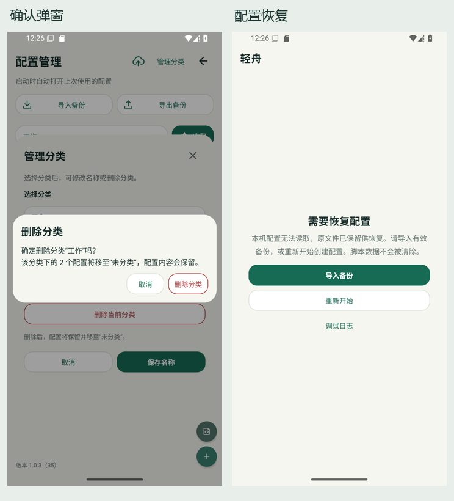
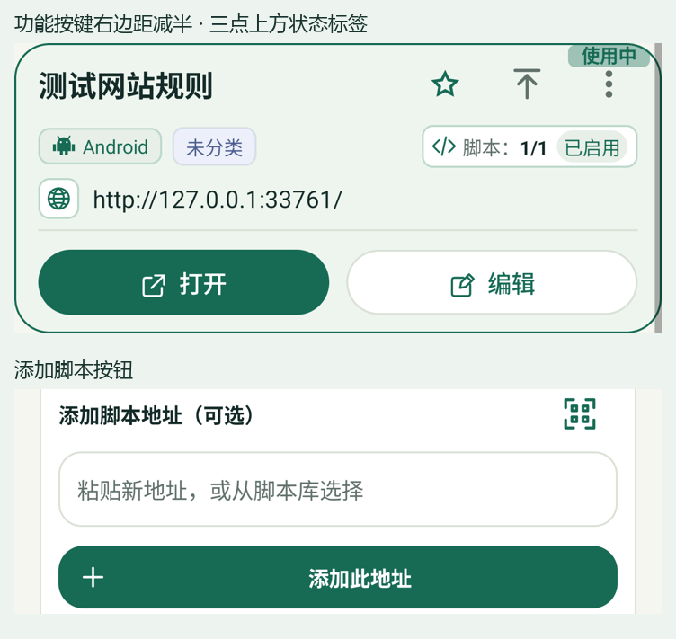

# 紧凑 UI 审查遗漏修复（2026-10-22）

完成紧凑布局后发现的三处遗漏已修复，延续原有深绿、浅底配色，版本保持 `1.0.3 (35)`，未提交、未推送。

## 修复

- 应用内 AppCompat 确认弹窗统一采用圆角浅底、20sp 标题、14sp 正文和紧凑按钮。覆盖分类/配置/脚本删除、重新开始、扫码结果、相机权限说明和脚本命令入口；删除及重新开始保留红色操作提示。自定义导入弹窗继续使用自己的内容布局。
- 错误与配置恢复页的重试、清缓存重试、导入、编辑/重新开始、日志按钮复用相同按钮样式，保留至少 48dp 触控区域。
- 配置切换列表和配置卡片统一使用同一个“使用中”字符串；脚本状态仍使用用户确认的“已启用”。

弹窗保留 AppCompat 的标题、正文、列表、自定义内容及按钮 ID 协议，没有改动点击回调、数据恢复或脚本执行逻辑。按钮空间不足时可换行排列，正文和命令列表仍可滚动。删除失败继续保留确认窗口及编辑状态。

## 本轮验证

专用 Android 15 临时只读模拟器 `emulator-5556`，安装本轮应用 APK 和测试 APK 后运行，检查了最终 instrumentation 结果。

| 范围 | 结果 |
| --- | --- |
| 新增 `CompactAlertUiTest`：长正文的三个按钮可达/回调，以及 24 项命令列表滚动选择 | 2/2 |
| `CategoryManagementUiTest` | 6/6 |
| `ScriptLibraryUiTest` | 15/15 |
| `ProfileFilterPersistenceTest` | 7/7 |
| `ProfileCardUiTest` | 3/3 |
| WebDAV 完整恢复、本地 ZIP 导入导出两个 UI 用例 | 2/2 |
| 320×640dp、2.0 倍字体，紧凑确认弹窗 | 2/2 |
| 480×320dp、2.0 倍字体，紧凑确认弹窗及分类管理 | 2/2、6/6 |
| 删除确认、恢复配置页截图检查 | 通过 |
| `testDebugUnitTest` | 138 项，0 失败/错误/跳过 |
| `lintDebug` | 0 Error，107 Warning |
| `assembleDebug` / `assembleDebugAndroidTest` / 固定签名校验 | 通过 |

35 个不同设备用例通过，小屏大字体矩阵为额外复测。最后仅移除测试文件的未使用导入，并为 AppCompat 必需的独立图标/标题节点添加局部 Lint 说明，随后重新构建应用与测试 APK、运行 Lint 和签名校验。未重跑真实摄像头识别或目标网站媒体播放。

显示尺寸、密度、字体已复原，临时模拟器已关闭；用于恢复页截图的损坏配置仅写入临时只读实例，不写回原 AVD。

## 预览

完整截图：[确认弹窗](screenshots/category-confirm-compact.png) · [配置恢复页](screenshots/recovery-compact.png)

安装包：`app/build/outputs/apk/debug/app-debug.apk`，`com.lightboat.app`，`1.0.3 (35)`，使用项目固定 debug 签名。

## 后续截图反馈：卡片按键与添加脚本

- 三个工具按键按用户最新要求恢复添加角徽前的布局与样式：48×48dp 区域、原始图标大小及默认居中绘制，不再单独下移三点图标。标题保持原来的单行省略，去掉卡片原有 6dp 顶部留白。
- 用户确认将斜角徽改为三点正上方的小横向标签，保留半透明底色、深绿色文字和上次使用的灰色状态。标签不占布局空间、不改变卡片高度、不拦截点击。它属于固定图标区内的辅助状态，视觉字号最多为默认 11sp 在 1 倍字体下的大小，完整状态仍提供给无障碍服务；标题与正文继续随系统字号缩放。
- “添加此地址”复用绿色实心按钮样式，增加加号和与输入框的间距，原添加逻辑不变。

最终小标签及原始按键版本验证：`ProfileCardUiTest` 普通竖屏 4/4、320×640dp / 2.0 倍字体 4/4；480×320dp / 2.0 倍字体的标签不占位与窄卡片两项检查 2/2。对比重新绑定为使用中、上次使用和无标签状态的卡片，确认高度及内容位置不变；检查图标尺寸和居中位置，以及标签与三点、置顶图标无重叠；更多菜单通过真实触摸打开。添加脚本及恢复未保存草稿的用例在前一轮 1/1 通过，本轮未改动该按钮。138 项单元测试通过，Lint 0 Error / 106 Warning，应用与测试 APK 构建及固定签名校验通过。测试显示设置已复原，临时只读模拟器已关闭。

最新右边距微调：按钮组右侧外边距由 14dp 减至 7dp，三个按钮及状态标签整体右移 7dp；按钮自身大小、组内间距和卡片正文位置保留。允许标题栏在父容器的右侧内边距内绘制，避免标签被裁切。本轮仅修改布局 XML；普通竖屏和 320×640dp / 2.0 倍字体的 `ProfileCardUiTest` 各 4/4 通过，截图、构建及固定签名检查通过，Lint 0 Error / 106 Warning。未重复执行 Kotlin 单元测试。Lint 首次遇到本机 JDK 17 的 C2 编译线程异常，使用仅对本次命令生效的 `-XX:TieredStopAtLevel=1` 重跑成功，未修改项目或 JDK 配置。
